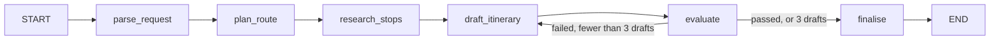

# Trip planner (LangGraph)

A LangGraph agent that plans a road trip between two places and writes the plan as a Markdown document. It checks each draft against a set of evals, records the results in Prefactor as quality, and revises the plan until the evals pass. It is traced in Prefactor with `PrefactorCallbackHandler`.

The planner uses free public APIs that need no key:

- [Nominatim](https://nominatim.org/) (OpenStreetMap) to find places and the towns along a route
- [OSRM](https://project-osrm.org/) for driving routes
- [Wikipedia](https://www.mediawiki.org/wiki/API:Main_page) for place summaries and nearby attractions
- [Open-Meteo](https://open-meteo.com/) for weather forecasts

Responses are cached for the life of the process, and Nominatim requests are spaced one second apart to follow its [usage policy](https://operations.osmfoundation.org/policies/nominatim/).

## The graph



| Node | What it does |
|---|---|
| `parse_request` | Extracts the origin, destination, number of days and interests from the request |
| `plan_route` | An agent with `geocode`, `get_route` and `find_towns_along_route` that chooses 2 to 6 stops |
| `research_stops` | Runs a research agent for each stop in turn, with `wikipedia_summary`, `nearby_attractions` and `weather_forecast` |
| `draft_itinerary` | Writes the day-by-day plan in Markdown, using feedback from failed checks on later drafts |
| `evaluate` | Runs the evals, records the result as `trip_plan_quality` quality, and sends the graph back to `draft_itinerary` when a check fails |
| `finalise` | Saves the plan to `out/<origin>-to-<destination>.md` |

Every model call sends the node's task as the system message and the original request as the only human message.

## Setup

From the repository root:

```bash
mise run install
cp packages/langchain/examples/trip_planner/.env.example .env  # then fill it in
```

| Variable | Meaning |
|---|---|
| `TOGETHER_API_KEY` | Together AI API key |
| `TOGETHER_MODEL` | Together AI model; defaults to `moonshotai/Kimi-K3`; any model you use must support tool calling |
| `PREFACTOR_API_URL` | Prefactor API URL, for example `http://localhost:4000` for a local server |
| `PREFACTOR_API_TOKEN` | Prefactor API token |
| `PREFACTOR_AGENT_ID` | Prefactor agent ID; omit it when the token is scoped to an agent deployment |
| `PREFACTOR_ENVIRONMENT_ID` | Prefactor environment ID; needed only for the first run of an agent that has no deployments |

## Run

From `packages/langchain/examples/trip_planner`:

```bash
uv run python main.py "Plan a 4-day road trip from Melbourne to Adelaide. I like wine and the coast."
```

A run takes a few minutes, mostly in route lookups and research.

## What you see in Prefactor

Open the agent instance and choose the conversation view:

- one user message with the request
- an agent run divider for the graph run (`langchain:agent`)
- a card for each node in order (`langchain:node`), named by the node
- under each node, its model calls (`langchain:llm`), tool calls and tool results (`langchain:tool`); calls made by the route and research agents appear under the node that ran them
- the trip plan is the reply to the last `draft_itinerary` model call
- a `trip_plan_quality` quality entry for each draft, with its score, attempt number and the result of every check

## Evals

The `evaluate` node runs these checks on every draft:

| Check | Passes when |
|---|---|
| `endpoints_named` | The plan names the origin and the destination |
| `day_count` | The plan has a `## Day N` section for each day asked for |
| `stops_per_day` | Every day names at least one stop in bold |
| `only_researched_stops` | Every place in bold is the origin or a researched stop |
| `daily_driving_limit` | No day has more than 400 km of driving, using the route distances to each stop |
| `grounded` | A model judges that every fact about a place is in the research notes |

The score is the share of checks that passed, out of 100. A draft passes only when every check passes. After 3 drafts the graph saves the last draft whether or not it passed.

The deterministic checks have unit tests. From the repository root:

```bash
mise run test packages/langchain/examples/trip_planner/test_evals.py
```

### Run the eval set

`run_evals.py` runs three fixed routes, each as an agent instance with the `eval` purpose, and exits with status 1 when any final plan fails. From `packages/langchain/examples/trip_planner`:

```bash
uv run python run_evals.py
```

In Prefactor, these runs carry an eval label in the agent's list of instances, which sets them apart from live runs.

### Add a hosted judge

Prefactor can also run a judge of its own on every completed run. In the Prefactor app, add a judge to the trip planner agent and set it to run on completion. A judge reads the whole run record, including the conversation, and records a pass or fail with an explanation as a separate quality entry on the instance. The in-graph evals decide whether to revise a draft during the run; the hosted judge gives an independent review afterwards.

Each span is created with an HTTP request before the step continues, which adds a little latency to every step.
